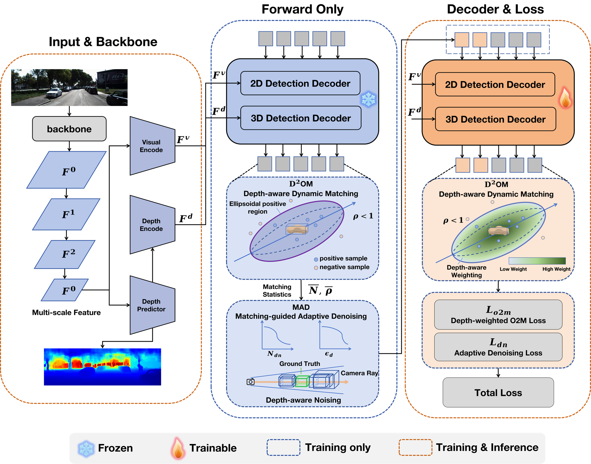

# D²OM: Depth-Aware Dynamic Matching for DETR-based Monocular 3D Detection

<div align="center">

[](LICENSE)
[](https://www.python.org/)
[](https://pytorch.org/)

</div>

<p align="center">
  
</p>

---

## 📖 Abstract

Monocular 3D object detection has attracted increasing attention due to its low-cost deployment advantages. However, DETR-based detectors suffer from extremely sparse supervision signals imposed by the one-to-one Hungarian matching strategy, which severely constrains convergence speed and detection performance. Although one-to-many training strategies have been widely validated in 2D detection, directly transferring them to monocular 3D detection presents fundamental limitations: existing methods define positive sample regions in an isotropic manner, overlooking the core characteristic that depth estimation errors substantially exceed lateral localization errors, leading to typical failure modes such as **duplicate detections along the depth direction** and **missed detections caused by depth shift**.

To this end, we propose **D²OM**, a Depth-aware Dynamic One-to-Many Matching training framework for DETR-based monocular 3D detectors, comprising two synergistic components:

- **D²OM** defines positive sample matching regions as anisotropic ellipsoids aligned with the camera ray, explicitly modeling the larger error tolerance along the depth direction, with a dynamic cost-thresholding mechanism that adaptively controls positive sample count to suppress low-quality matches early in training while progressively increasing supervision density as the model converges.
- **MAD** (Matching-guided Adaptive Denoising) takes one-to-many matching statistics as real-time observations to dynamically adjust the number of denoising queries and noise magnitude, and introduces depth-aware denoising query groups to specifically reinforce depth estimation accuracy.

> Both modules are active **only during training** and introduce **no additional overhead** at inference time.

Extensive experiments on the KITTI benchmark demonstrate that D²OM consistently improves the performance of multiple strong DETR-based monocular 3D detectors without relying on any auxiliary depth data, achieving gains of **3.04%** and **3.63%** in $AP_{3D}$ and $AP_{BEV}$ on the Moderate validation set, respectively, reaching state-of-the-art performance.

---

## 🛠️ Installation

**1. Clone and create environment**

```bash
cd MonoD2OM
conda create -n monod2om python=3.8
conda activate monod2om
```

**2. Install PyTorch and torchvision** (matching your CUDA version)

```bash
# Install torch, torchvision, torchaudio
```

**3. Install requirements and compile deformable attention**

```bash
pip install -r requirements.txt

cd lib/models/monod2om/ops/
bash make.sh
cd ../../../..
```

**4. Prepare KITTI dataset**

Download [KITTI 3D Object Detection](http://www.cvlibs.net/datasets/kitti/eval_object.php?obj_benchmark=3d) and organize as follows:

```
MonoD2OM/
├── ImageSets/
├── training/
│   ├── image_2/
│   ├── label_2/
│   └── calib/
└── testing/
    ├── image_2/
    └── calib/
```

> You can also update the data path at `dataset/root_dir` in `configs/monod2om.yaml`.

---

## 🚀 Getting Started

### Training

Modify model and training settings in `configs/monod2om.yaml`, then run:

```bash
bash train.sh configs/monod2om.yaml > logs/monod2om.log
```

### Testing

The best checkpoint is evaluated by default. Change it at `tester/checkpoint` in `configs/monod2om.yaml`:

```bash
bash test.sh configs/monod2om.yaml
```

To benchmark inference speed on your own device:

```bash
python tools/test_runtime.py
```

---

## 📊 Results on KITTI Val Set

<table align="center">
    <tr>
        <td rowspan="2" align="center"><b>Models</b></td>
        <td colspan="3" align="center"><b>Car@3D IoU=0.7</b></td>
        <td colspan="3" align="center"><b>Car@BEV IoU=0.7</b></td>
        <td rowspan="2" align="center"><b>Weights</b></td>
    </tr>
    <tr>
        <td align="center"><b>Easy</b></td>
        <td align="center"><b>Mod.</b></td>
        <td align="center"><b>Hard</b></td>
        <td align="center"><b>Easy</b></td>
        <td align="center"><b>Mod.</b></td>
        <td align="center"><b>Hard</b></td>
    </tr>
    <tr>
        <td align="center">MonoD²OM</td>
        <td align="center">32.89</td>
        <td align="center">25.38</td>
        <td align="center">22.24</td>
        <td align="center">42.35</td>
        <td align="center">31.83</td>
        <td align="center">28.22</td>
        <td align="center"><a href="https://pan.baidu.com/s/1W1ipQ5RhOyLeLQCuUUW5SQ?pwd=9nug">Download</a></td>
    </tr>
</table>

---

## 🙏 Acknowledgement

This work builds upon the following excellent projects:

- [MonoDETR](https://github.com/ZrrSkywalker/MonoDETR)
- [MonoDGP](https://github.com/PuFanqi23/MonoDGP)
- [DINO](https://github.com/IDEA-Research/DINO)
- [DN-DETR](https://github.com/IDEA-Research/DN-DETR)
